<p align="center">
  
</p>

<p align="center"><i>"There are no strings on me."</i></p>

<br>

Hi, I'm **Daniel** — a.k.a. **ultron**.

I'm into **cybersecurity** and staying up to date with how systems break (and how to protect them).
I like **automating** everything that can be automated and solving problems with clean, practical code.

```yaml
/summon ultron
  name:      Daniel
  class:     Security Enthusiast · Automation Builder
  crafting:  tools in Go & Python, web apps in PHP
  mining:    cybersecurity, Linux, new tech
  objective: automate the boring, secure the rest
```

### ⛏ Inventory

<p>
  
</p>

<br>

<p align="center">
  
</p>
